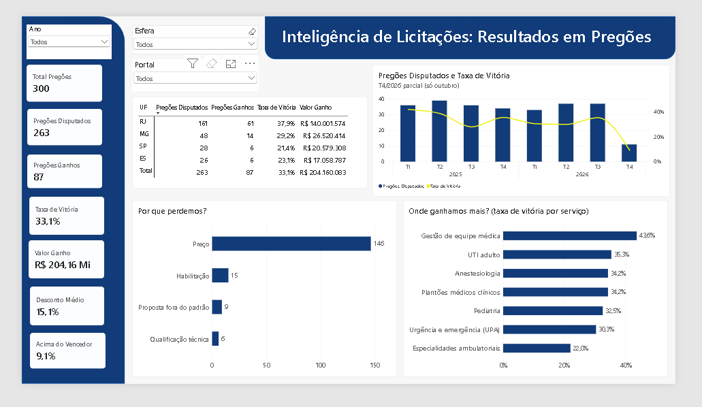

# Análise de desempenho em licitações públicas com SQL e Power BI

   

> ⚠️ **Dados 100% fictícios**, criados para estudo. Não representam nenhuma empresa ou órgão real.

Projeto em duas etapas: **exploração em SQL** (SQLite) e **dashboard executivo em Power BI**, respondendo onde uma empresa de gestão em saúde ganha e perde pregões, e por quê.



## Contexto do problema
Uma empresa de **gestão em saúde** participa de pregões eletrônicos para prestar serviços a órgãos públicos. A diretoria quer entender **onde ganha, onde perde e por quê**, para decidir em quais pregões vale a pena entrar e o que melhorar nas propostas.

## Base de dados
O arquivo [`dados/base_pregoes.sql`](dados/base_pregoes.sql) cria e popula duas tabelas:

**`pregoes`**: um registro por pregão disputado (40 registros, jan a out/2026).

| Coluna | Tipo | Descrição |
|---|---|---|
| `id` | INTEGER | Identificador do pregão |
| `data_sessao` | TEXT | Data da sessão pública (AAAA-MM-DD) |
| `orgao` | TEXT | Órgão que abriu o pregão (liga com `orgaos.orgao`) |
| `uf` | TEXT | Estado do órgão (RJ, MG, SP, ES) |
| `objeto` | TEXT | Serviço licitado (ex.: Clínica médica, Anestesiologia, Plantão médico) |
| `valor_estimado` | REAL | Valor de referência do edital (R$) |
| `valor_proposto` | REAL | Valor da nossa proposta (R$) |
| `valor_arrematado` | REAL | Valor vencedor do pregão (R$) |
| `resultado` | TEXT | Ganho, Perdido ou Desclassificado |
| `motivo_perda` | TEXT | Preço, Documentação ou Atestado técnico (vazio quando ganho) |

**`orgaos`**: órgãos públicos acompanhados pela empresa (17 registros).

| Coluna | Tipo | Descrição |
|---|---|---|
| `orgao` | TEXT | Nome do órgão |
| `esfera` | TEXT | Municipal ou Estadual |
| `analista` | TEXT | Analista de licitações responsável (Ana, Bruno ou Carla) |

## Perguntas de negócio
1. Qual é o panorama geral: quantos pregões ganhamos, perdemos ou fomos desclassificados?
2. Quais são os principais motivos de perda e desclassificação?
3. Em quais órgãos, estados, esferas e objetos temos melhor e pior desempenho?
4. Quão longe ficamos do preço vencedor quando perdemos por preço?
5. O desempenho varia entre os analistas responsáveis?

## Dashboard Power BI: Inteligência de Licitações
Painel de uma página para a diretoria acompanhar os resultados em pregões. Usa uma **base fictícia ampliada**: 300 pregões registrados de 2025 a outubro de 2026, em RJ, MG, SP e ES.

**Filtros:** Ano, Esfera e Portal de compras.

**Indicadores (cards):**

| Indicador | Resultado | O que mede |
|---|---:|---|
| Total de pregões | **300** | Pregões registrados na base |
| Pregões disputados | **263** | Pregões em que a empresa efetivamente participou |
| Pregões ganhos | **87** | Pregões vencidos |
| Taxa de vitória | **33,1%** | Ganhos ÷ disputados |
| Valor ganho | **R$ 204,16 mi** | Soma dos valores dos pregões vencidos |
| Desconto médio | **15,1%** | Desconto médio das propostas em relação ao valor estimado |
| Acima do vencedor | **9,1%** | Quanto, em média, a proposta ficou acima da vencedora nos pregões perdidos |

**Visuais:**
- **Tabela por UF:** disputados, ganhos, taxa de vitória e valor ganho por estado.
- **Pregões disputados e taxa de vitória por trimestre:** colunas e linha (o T4/2026 é parcial e inclui só outubro).
- **Por que perdemos?:** pregões perdidos por motivo.
- **Onde ganhamos mais?:** taxa de vitória por tipo de serviço.

### Principais insights
1. **O preço é o grande gargalo:** 146 dos 176 pregões perdidos (83%) foram perdidos por preço. Nas perdas, a proposta ficou em média **9,1% acima da vencedora**, uma margem que orienta a revisão da precificação.
2. **Perdas por documentação são evitáveis:** habilitação, proposta fora do padrão e qualificação técnica somam 30 perdas (17%). Um checklist de habilitação antes da sessão ataca esse problema diretamente.
3. **O RJ é o mercado principal:** concentra 161 dos 263 pregões disputados (61%), tem a maior taxa de vitória (**37,9%**) e responde por **R$ 140 mi** do valor ganho (69%).
4. **SP e ES pedem estratégia própria:** as taxas de vitória ficam em 21,4% e 23,1%, bem abaixo da média de 33,1%.
5. **Serviços mais competitivos:** Gestão de equipe médica (**43,6%**) lidera. Especialidades ambulatoriais (**22,0%**) têm o pior desempenho.

| UF | Disputados | Ganhos | Taxa de vitória | Valor ganho |
|---|---:|---:|---:|---:|
| RJ | 161 | 61 | 37,9% | R$ 140.001.574 |
| MG | 48 | 14 | 29,2% | R$ 26.520.414 |
| SP | 28 | 6 | 21,4% | R$ 20.579.308 |
| ES | 26 | 6 | 23,1% | R$ 17.058.787 |
| **Total** | **263** | **87** | **33,1%** | **R$ 204.160.083** |

## Ferramentas
- **SQL** (SQLite)
- [sqliteonline.com](https://sqliteonline.com) para executar as consultas no navegador
- **Power BI** (modelagem, medidas DAX e dashboard)

## Principais conclusões da etapa SQL *(em andamento)*
| Indicador | Resultado |
|---|---:|
| Pregões analisados | **40** |
| Vitórias | **60%** |
| Perdidos | **27,5%** |
| Desclassificados | **12,5%** |

As consultas estão em [`consultas/analise_pregoes.sql`](consultas/analise_pregoes.sql), cada uma identificada pela pergunta que responde (P0.1, P1...).

## Como executar
1. Acesse [sqliteonline.com](https://sqliteonline.com) (motor **SQLite**).
2. Copie e execute todo o conteúdo de `dados/base_pregoes.sql` para criar as tabelas.
3. Execute as consultas de `consultas/analise_pregoes.sql`, uma de cada vez.

## Estrutura
```
analise-pregoes-sql/
├── dados/base_pregoes.sql
├── consultas/analise_pregoes.sql
├── imagens/dashboard_resultados_pregoes.png
└── README.md
```

## Autora
**Gyovanna Flores**, assistente de licitações sênior em transição para análise de dados.
[LinkedIn](https://www.linkedin.com/in/gyovannaflor/)
